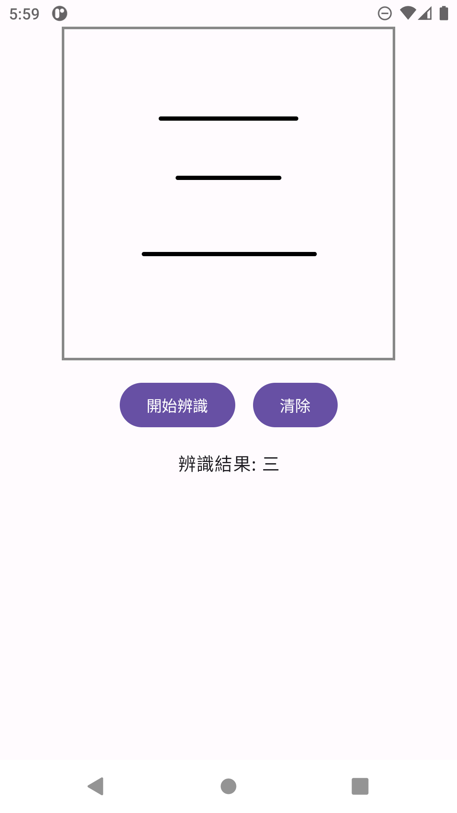

# DigitalInk 塗鴉辨識

依第七章《畫布與手寫辨識（Digital ink recognition）》實作，畫面採用課件與提供截圖的配置：300dp 灰框手寫區、紫色「開始辨識」與「清除」按鈕、辨識結果文字。

## 開啟

1. Android Studio 選 Open，選取 DigitalInk 資料夾（不是單一 .kt 檔）。
2. Gradle JDK 選 JDK 21。這部電腦可用 school/.android-toolchain/jdk-21。
3. 等待 Gradle Sync 完成，選 app 與模擬器，再按 Run。
4. 用滑鼠在模擬器的方框中按住拖曳寫字，或在手機用手指書寫。

## 使用

- 可以連續寫多筆，抬起後再寫不會清掉上一筆。
- 按「開始辨識」使用 Google ML Kit 的繁體中文 zh-Hant 模型。
- 首次辨識需要網路下載語言模型。下載完成後，辨識於裝置執行。
- 按「清除」同時清掉畫面、筆畫資料及結果。
- 清除或開始新筆畫會忽略舊辨識工作的回覆，避免結果突然回來覆蓋畫面。
- 旋轉螢幕保留筆畫；結束 App 之後重新啟動則是空白畫布。
- 真實手寫辨識結果會受字跡、筆順影響，不是固定顯示預設文字。

## 建置與測試

使用 JDK 21 和 Android SDK 36：

    gradlew.bat :app:assembleDebug :app:testDebugUnitTest :app:lintDebug

APK：app/build/outputs/apk/debug/app-debug.apk

## 主要程式

- MainActivity.kt：Compose 畫面、Canvas 與觸控筆畫收集。
- InkViewModel.kt：模型下載、辨識、清除及畫面狀態。
- InkDocument.kt：筆畫與時間點資料。
- InkDocumentTest.kt：多筆、單點、清除、快照、取消測試。

依附套件：com.google.mlkit:digital-ink-recognition:19.0.0。
本專案沒有提交至學校平台。

GitHub：[humans048/DigitalInk](https://github.com/humans048/DigitalInk)

## 實際執行畫面

